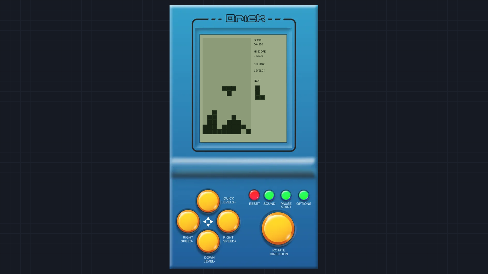
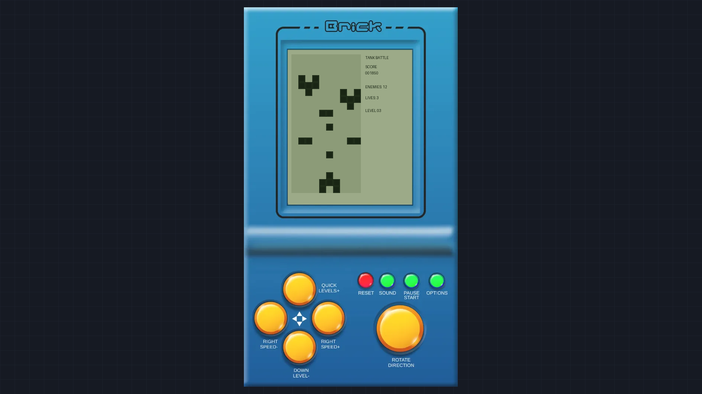
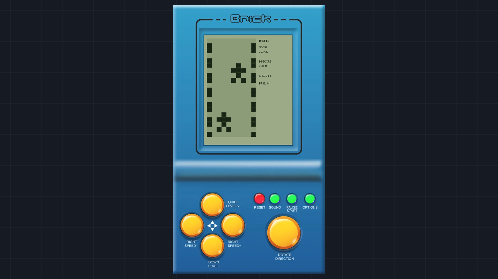

# 🎮 Brick Game: Retro Classic (9999 in 1 Definitive Edition)

[](https://en.wikipedia.org/wiki/HTML5)
[](https://developer.mozilla.org/en-US/docs/Web/JavaScript)
[](https://developer.mozilla.org/en-US/docs/Web/API/Web_Audio_API)
[](https://opensource.org/licenses/MIT)

> An authentic, tournament-grade web recreation of the iconic 1990s E-9999 handheld LCD brick gaming console. Built with 100% clean-room HTML5 Canvas, pure vanilla JavaScript, and procedural 8-bit piezo Web Audio synthesis.

---

## 🕹️ Live Demo
👉 **[Play Brick Game Live on GitHub Pages](https://coder-sachin28.github.io/brick-game/)**

---

## 📸 Screenshots

| Classic Tetris Mode | Retro Tank Battle | High-Speed Racing |
| :---: | :---: | :---: |
|  |  |  |

---

## ✨ Features

- **🎮 4 Iconic 1990s Game Modes in 1 Console:**
  - **Mode A - Classic Falling Bricks (Tetris):** 7-bag randomizer, Super Rotation System (SRS) wall kicks, ghost projection, hold piece, 4-line Tetris clears.
  - **Mode B - Retro Tank Battle:** Player tank defense, destructible brick barricades, advancing enemy battalions, and dual bullet physics.
  - **Mode C - Racing Dodger:** 3-lane speedway, oncoming traffic avoidance, 20 escalating speed tiers, and reactive obstacle passing.
  - **Mode D - Classic Snake:** Retro grid movement, food spawning, dynamic tail growth, and high-precision input buffering.
- **🔊 Authentic 1-Bit Piezo Acoustics:**
  - Procedural Web Audio API square-wave synthesizer reproducing the exact pitch and ADSR decay of 1990s buzzer hardware with **zero external MP3/audio files**.
- **🎨 Interactive Theme Studio:**
  - Switch between classic retro plastic shells: **Yellow Classic**, **Game Boy Gray**, **Turquoise Blue**, **24K Gold VIP**, and **Neon Cyberpunk Matrix**.
  - Built-in Custom Color Builder to customize shell plastic, LCD glass tint, and button colors.
- **📱 Dual Mobile Control Layouts:**
  - **Split-Thumb Layout:** Optimized for modern widescreen smartphones with left/right thumb steering.
  - **Nostalgia D-Pad Layout:** Authentic cross-pad reproduction mimicking the physical handheld console.
- **⚡ Zero Dependencies & Instant Load:**
  - Total bundle size is under **40 KB**. Instant sub-second loading without any third-party framework or heavy engine overhead.
  - 100% offline and incognito-safe with memory-fallback storage.

---

## ⌨️ Controls

### Keyboard Controls (Desktop)
| Action | Key(s) |
| :--- | :--- |
| **Move Left / Right** | `A` / `D` or `Left Arrow` / `Right Arrow` |
| **Soft Drop** | `S` or `Down Arrow` |
| **Hard Drop** | `Space` or `W` or `Up Arrow` |
| **Rotate Piece** | `Up Arrow` or `W` or `Action Button` |
| **Hold Piece** | `C` or `Shift` |
| **Start / Power** | `Enter` or `On/Off Button` |
| **Sound Toggle** | `M` |
| **Pause Game** | `P` |
| **Reset Game** | `R` |

### Touch Controls (Mobile)
- High-visibility on-screen touch buttons with repeat-fire (DAS/ARR) timing.
- Direct tap on the **HOLD** preview box on the LCD display to swap active tetrominoes!

---

## 🚀 Running Locally

1. Clone this repository:
   ```bash
   git clone https://github.com/Coder-SACHIN28/brick-game.git
   cd brick-game
   ```

2. Serve using any local web server (no build tools required):
   ```bash
   # Python 3
   python -m http.server 8080

   # Or using Node npx
   npx serve .
   ```

3. Open `http://localhost:8080` in your web browser and enjoy!

---

## 📄 License
This project is open-source under the **[MIT License](LICENSE)**.

Developed with ❤️ by **[Sachin Kumar (@Coder-SACHIN28)](https://github.com/Coder-SACHIN28)**
